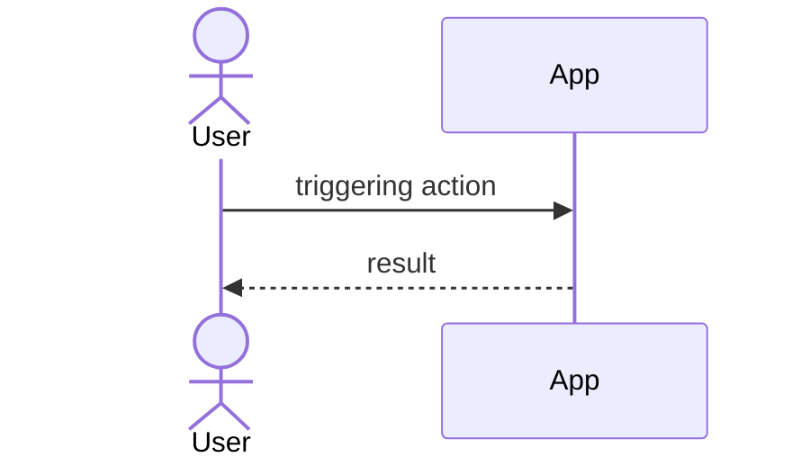

# PRD: {{title}}

## Problem

What's broken or missing, and for whom — 2-3 sentences, no more.

## Goals / Non-goals

- Goal: 
- Non-goal: 

## Interaction overview

How the user and the app interact for the primary flow — one diagram, not prose.

## Use cases

One block per use case. Keep each flow to the steps that matter — a use case is a contract, not a narrative.

### UC-1: {{name}}

- **Precondition:** 
- **Main flow:**
  1. 
  2. 
- **Alt flows:**
  - A1 ({{condition}}): 
  - A2 ({{condition}}): 

### UC-2: {{name}}

- **Precondition:** 
- **Main flow:**
  1. 
- **Alt flows:**
  - A1 ({{condition}}): 

## Success criteria

- Measurable, observable — if you can't tell whether it happened, it's not a success criterion yet.

## Open questions

- [ ] Question needing an answer before Design can start
